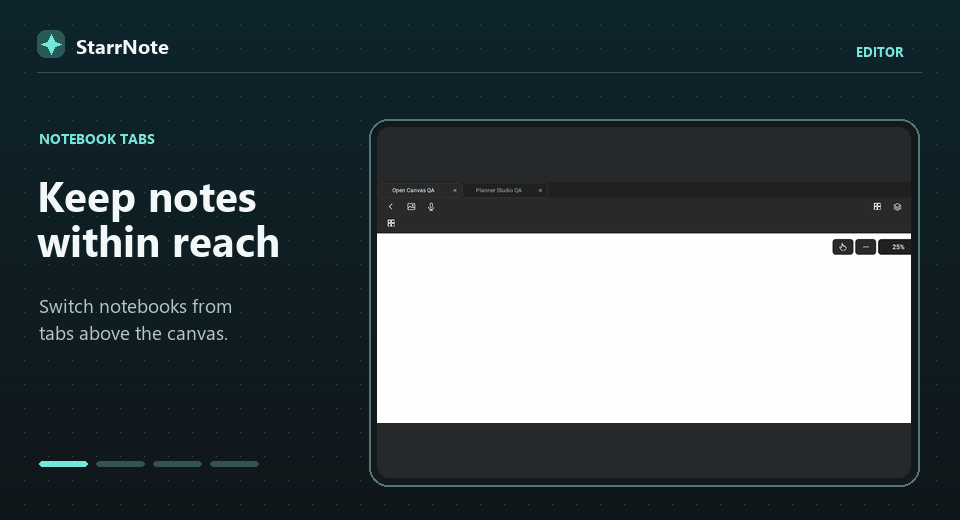
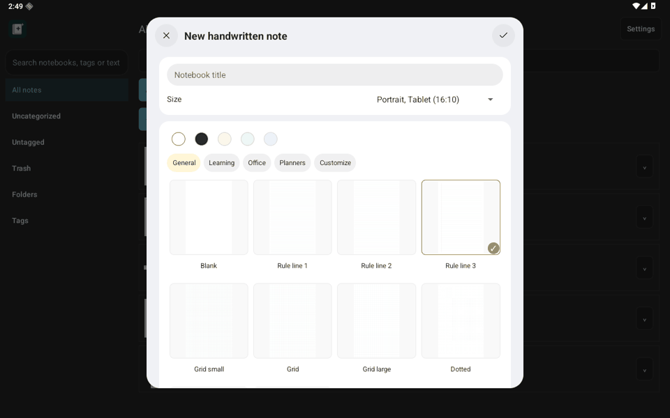

# StarrNote

StarrNote is a native Android notebook for handwriting, PDF annotation, and planning. Open several notebooks in tabs, draw on an infinite canvas, or start with a paper template.

[Editor](#editor) · [Paper and planners](#paper-and-planners) · [Build from source](#build-from-source)

## Editor



- Pan and zoom the infinite canvas. Wide landscape screens have a right-side drawing toolbar.
- Choose from 16 brushes. Adjust pressure sensitivity on the fountain and calligraphy pens, and save brush settings to the Pen Box.
- Annotate imported PDFs, insert images into notes, and export notebooks as PDFs or pages as images.
- Organize notebooks with folders and tags, add audio clips, and export or restore a library backup.

## Paper and planners



Choose paper size, orientation, and color in the template picker. **Notebook Paper** has a red margin and three punch holes. Six planner layouts cover daily schedules, weekly plans, and to-do lists across four themes. Both weekly layouts start on **Saturday**.

## Build from source

Use **JDK 17** and install **Android SDK Platform 36**. The app runs on Android 8.0 (API 26) and newer.

```sh
git clone https://github.com/abdullah120230053-star/S-Note.git
cd S-Note
./gradlew :app:assembleDebug :app:lintDebug
```

On Windows, run `.\gradlew.bat :app:assembleDebug :app:lintDebug`. Set `ANDROID_HOME` to your Android SDK path or open the project in Android Studio and let it configure the SDK.

The debug APK is generated at `app/build/outputs/apk/debug/app-debug.apk`. Use `:app:installDebug` to install it on a connected Android device or emulator.
